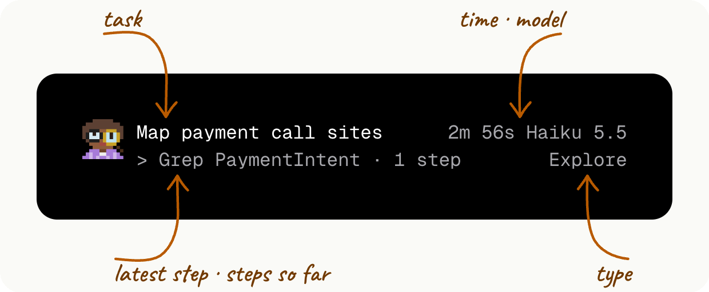
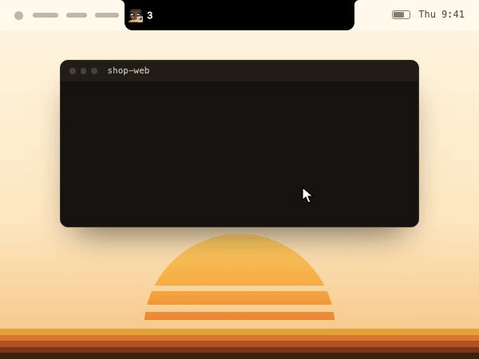
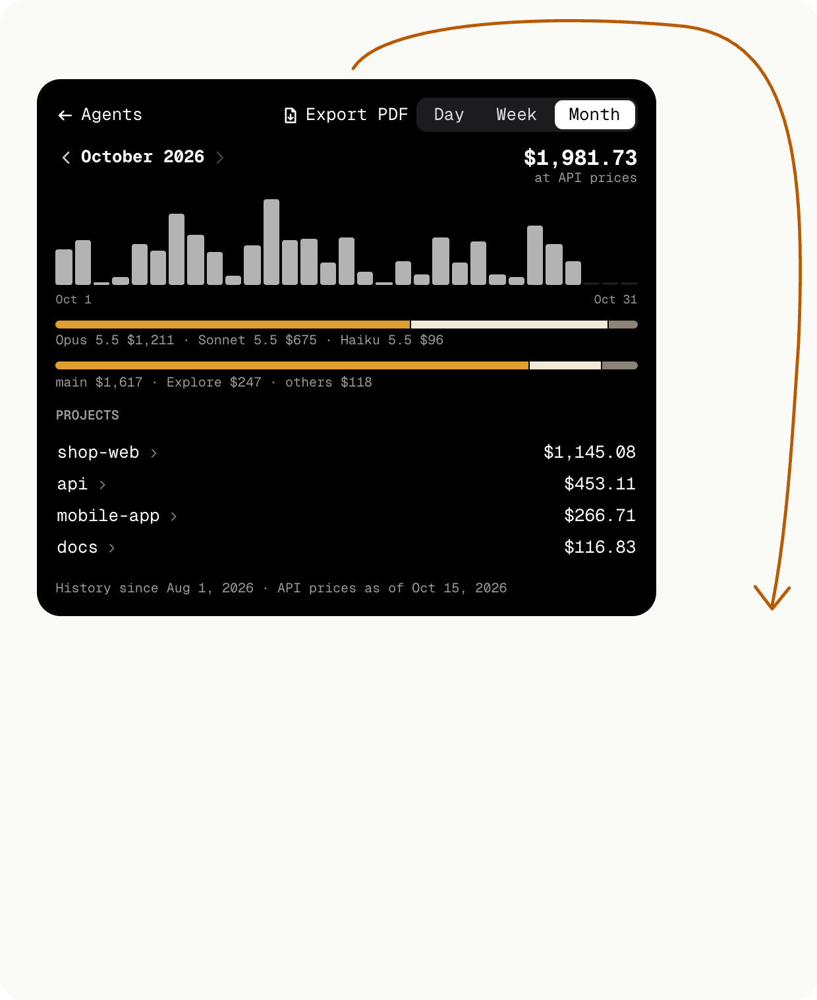
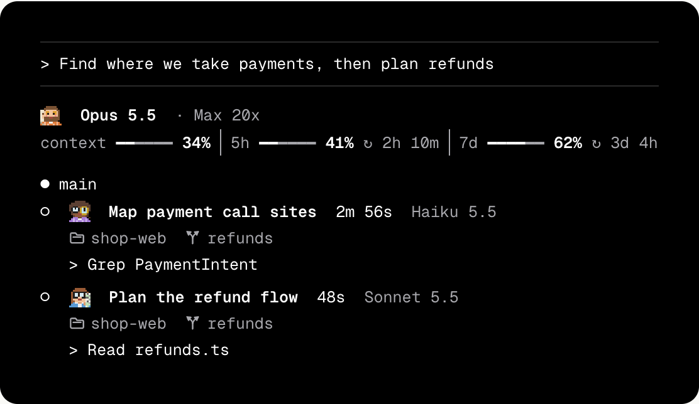
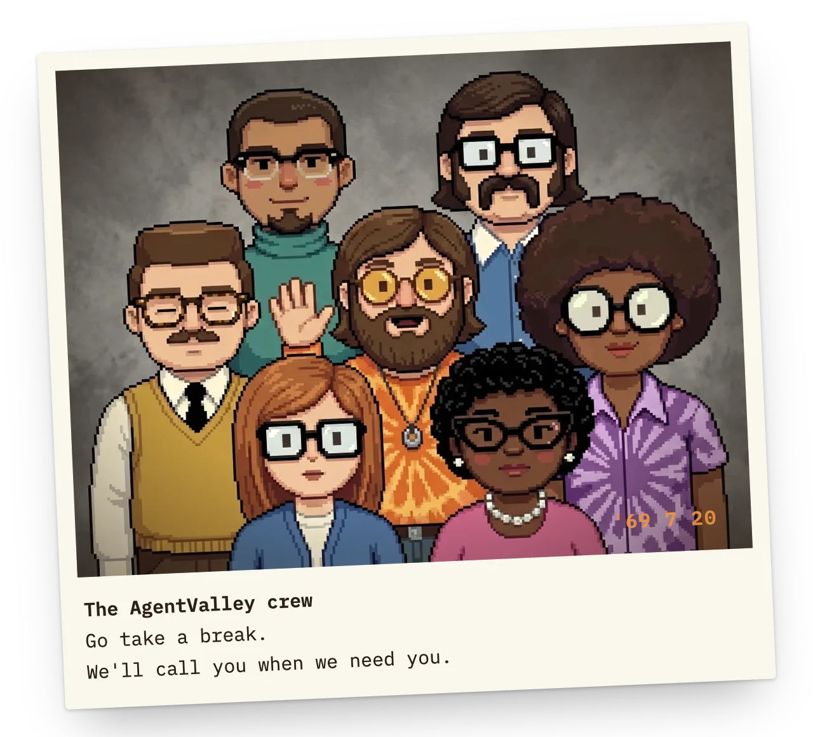
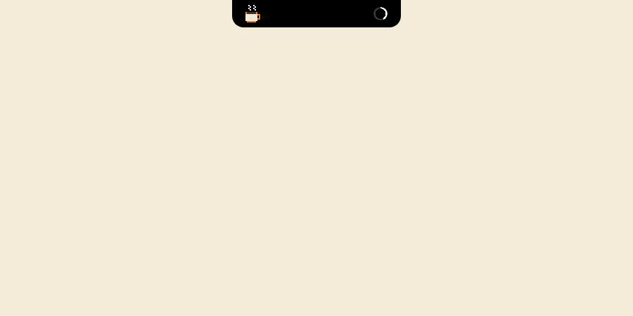

<div align="center">

<picture>
  <source media="(prefers-color-scheme: dark)" srcset="docs/logo-dark.svg">
  
</picture>

<a href="https://www.producthunt.com/products/agentvalley?embed=true&utm_source=badge-top-post-badge&utm_medium=badge&utm_campaign=badge-agentvalley"></a>

### Every agent, at a glance, right in your notch.

A small valley of programmers in your Mac's notch. Each Claude Code agent, sub-agents too, gets its own row and its own little programmer.


**[agentvalley.app](https://agentvalley.app)** · [Comics](https://agentvalley.app/comics/) · [Sponsor the crew](https://github.com/sponsors/morsechimwai)

<sub>Only for Claude Code, on Mac · Free · Open source · macOS 15 or later · For MacBooks with a notch</sub>

</div>

## Five agents running. Which one is waiting for you?

Each agent reports in its own terminal, line by line. Run a few sessions at once and you end up switching windows just to check on them. AgentValley puts all of them in one panel under the notch. See who is working, on which model, and who needs you, without leaving your app.

<p align="center"></p>

## Try it

**1. Install.** **[Download for Mac](https://github.com/morsechimwai/agent-valley/releases/latest/download/AgentValley.dmg)**. Open AgentValley.dmg and drag AgentValley into Applications. macOS asks once if you want to open an app from the internet: choose Open.

Or with Homebrew:

```sh
brew install --cask morsechimwai/tap/agent-valley
```

**2. Open it** from Applications. The panel opens once to show where it lives.

**3. Point at the notch.** The panel opens with a row for every agent. When one needs you, a red count appears beside the notch and its programmer waves. Click a row to jump to that agent's app. From any app, ⌃⌥⌘A opens the panel too: arrows to pick, Return to jump.

Signed, and Apple checked our papers. Needs macOS 15 or later and Claude Code. Made for MacBooks with a notch.

Once an hour we check for a new version, and we ask before we install it.

We moved house in 0.2. On 0.1 from Homebrew? Run `brew uninstall --formula agent-valley`, then install again as above. Using the plugin? Copy its command from Settings once more, so it finds the new address. Put the crew in your terminal? Run its install command from the Claude Code settings once more too.

<details>
<summary>Remove</summary>

First take out what you added yourself:

- The plugin: `claude plugin uninstall notch-answers@agent-valley && claude plugin marketplace remove agent-valley`
- The crew in your terminal: the command under How to take it out, in the app's Claude Code settings.

Then quit the app and move it from Applications to the Bin, or run `brew uninstall --cask agent-valley`. Your History stays in `~/Library/Application Support/AgentValley` until you delete that folder.

</details>

## What you get

### Every agent gets a row

Sessions get a card, and the sub-agents they start get rows under it. Each row shows the task, the model and the latest step, and sub-agent rows count their steps too. Every session sits in one list, whichever terminal it runs in, grouped by project. Worktrees count as their project. No guessed progress bars: if an agent goes quiet, AgentValley says so.

<p align="center"></p>

### Know the moment one needs you

When an agent asks a question or waits for permission, a red count appears beside the notch. Open the panel to read the question or the command. Each one that waits gets a red badge with how long it has waited, and past a minute the longest wait shows beside the notch too.

<p align="center"></p>

- **Jump to its app in one click.** Turn on Go to the session's tab in the Shortcuts settings, and Terminal and iTerm2 open the exact tab. Ghostty does too, unless two sessions run in the same folder.
- **Answer from the notch.** Allow once or Deny, using a plugin that comes with the app: press Install the plugin in the Claude Code settings (or run the command it shows in a terminal), then start Claude Code again. Until it's in, every session that waits on you has a button that takes you there.
- **We talk.** With sounds on, whoever runs the session plays a few notes on their own instrument and says what it needs: a command, an edit, a question, a plan. Rather have a plain chime? Settings has one. Sounds are on from the start, and one switch in Settings turns them off.

### See what each project cost

Open History from the chart button at the top of the panel. Pick a day, a week or a month, at API prices. It stays on your Mac, even after Claude Code clears its old files. Export PDF writes a statement of work: every project for you, or one project for your team or a client. A project you move or rename keeps its history, and two folders that share a name stay two projects.

<p align="center"></p>

### The crew in your terminal too

Claude Code's status line gets the face of whoever runs the session, with the model, your plan and your limits. Each sub-agent row under the prompt gets its own face, its model, the step it's on, and the notch's own marks for its folder and branch. Send three or more of us and we each take one line, so nobody drops off the bottom. We hold the same things there as in the notch, but we keep still. Until your first prompt only a coffee waits there, on standby, and when a limit runs out we go fishing, or take the van. One command from the app's Claude Code settings sets it up. With the app closed your limits still show, and the coffee waits. We travel as a font, and we've been seen in Terminal, iTerm2, Ghostty and Cursor.

<p align="center"></p>

### Also in the panel

- **Plan limits.** Your Claude 5-hour and weekly limits, with time left until reset. Off until you turn it on. When one runs out we go fishing, or take the van for the weekly one, and a sign says when we're back.
- **Token use.** Tokens for the last 5 hours and today, with a 12-hour chart.
- **Another display.** MacBook off to the side, big screen in front? Settings › General › Display moves us to the top of the big one, on any display plugged into your Mac. Unplug it and we go back to the notch. Asked for in [issue #1](https://github.com/morsechimwai/agent-valley/issues/1).

<p align="center"></p>

## Meet the crew

We're seven programmers from a computer room in 1969. We build things because we can't stop, not because anyone told us to. After work there's beer and a stack of records, and a smell in the room the janitor stopped asking about a long time ago. Now we live in your Mac's notch.

<p align="center"></p>

Sunny, Walt, Norm and Pearl run sessions: start Claude Code and one of them takes it. Each project gets a regular, the same one of us every session. Open a second session there at the same time and a colleague takes it, since nobody is in two places at once. Judy, Faye and Felix take the sub-agent jobs a session hands out.

In Claude Code we call each other by name. Norm hands a search to Faye with “Faye takes the search. Sending it now.” and Faye brings it back with “Norm, two call sites, no surprises.” We each talk in our own voice, in the language you write in. Your code, commits and files stay exactly as they would be without us. It comes with the plugin, from your next session on. Crew names in Claude Code, in the Claude Code settings, turns it off.

<table>
<tr><td width="76"></td><td><b>Sunny</b>, the guru · runs a session<br>Yoga at sunrise, then code until the sun goes down again. He believes every bug came to teach him something. When he waves, an agent is waiting for you.</td></tr>
<tr><td width="76"></td><td><b>Walt</b>, the walrus · runs a session<br>Friday nights he plays bass in a garage band. A neighbour once asked about the smoke coming out, and Walt said it was a barbecue. Nobody has seen the grill yet.</td></tr>
<tr><td width="76"></td><td><b>Norm</b>, the engineer · runs a session<br>The only one of us who irons his shirt for work. He came over from a rocket launch control room and gets through a science fiction novel a night. He blinked in the team photo, and he says he meant to.</td></tr>
<tr><td width="76"></td><td><b>Pearl</b> · runs a session<br>She knows the computer better than the people who built it. Detective novels taught her to hunt bugs from the last page back. The pearls stay on, even when she crawls under the machine.</td></tr>
<tr><td width="76"></td><td><b>Judy</b> · the Plan sub-agent<br>Nobody touches a keyboard until Judy has the plan on paper. In the evenings she plays folk guitar by the campfire, mostly songs she wrote about flowcharts.</td></tr>
<tr><td width="76"></td><td><b>Faye</b> · the Explore sub-agent<br>Faye reads every file until she finds the one you meant. On weekends she disappears into the desert and always comes back with new ideas. What she found out there, she has never said.</td></tr>
<tr><td width="76"></td><td><b>Felix</b> · the General-purpose sub-agent<br>Any job without a name goes to Felix. On Thursday nights he reads poetry in a basement coffeehouse, and he plays the bongos while the machine runs. For every other kind of sub-agent he turns up in a different shirt.</td></tr>
</table>

### How to read us

How we stand tells you how the agent is doing.

<table>
<tr>
<td align="center" width="112"><br><b>Working</b><br>we blink</td>
<td align="center" width="112"><br><b>Needs you</b><br>we wave</td>
<td align="center" width="112"><br><b>Quiet</b><br>we look away</td>
<td align="center" width="112"><br><b>Done</b><br>our eyes close</td>
<td align="center" width="112"><br><b>Nothing running</b><br>a cup of coffee</td>
</tr>
</table>

While the agent works, we hold what it's on. Six seconds in hand, two to put it down.

<table>
<tr>
<td align="center" width="96"><br><b>Thinking</b><br>chin in hand</td>
<td align="center" width="96"><br><b>Read</b><br>a printout</td>
<td align="center" width="96"><br><b>Edit</b><br>a keyboard</td>
<td align="center" width="96"><br><b>Bash</b><br>a terminal</td>
<td align="center" width="96"><br><b>Grep</b><br>a magnifier</td>
<td align="center" width="96"><br><b>Agent</b><br>on the phone</td>
</tr>
</table>

One session from start to finish: Sunny adds a Pro paywall to an AI meeting notes app. He phones Faye and Judy for help, Felix writes the tests and runs them, and Sunny builds the paywall himself.

<p align="center"></p>

## The Valley Funnies

Between sessions we draw comics about the job. This one is about lunch.

<p align="center"><a href="https://agentvalley.app/comics/lunch-break/"></a></p>

Eight more at [agentvalley.app/comics](https://agentvalley.app/comics/).

## It reads. It doesn't touch.

- Reads `~/.claude/projects` and `~/.claude/sessions`, the files Claude Code writes as it works.
- Looks at Claude Code's processes and each project's `.git` to show which app and branch a session is in. From `.git` it also reads the address of the project's remote, such as its GitHub page, so History knows a project after you move or rename it. That address stays on your Mac, without any login in it.
- Reads your Claude Code login from the Keychain only when you turn on Plan limits, and sends it only to api.anthropic.com.
- Asks GitHub once an hour whether there's a new version. That's the whole conversation. Turn it off in Settings.
- Sends us one count a day, so we know how many Macs run it: the app version, the macOS version, and whether it's this Mac's first day. No name, no ID, nothing about your sessions. Turn it off in Settings.
- Besides its own settings and its updates, it writes only in one folder: `~/Library/Application Support/AgentValley`. Nothing in `~/.claude` changes, unless you put the crew in your terminal.
- You start that yourself, with a command from the app's settings. It sets the status line in `~/.claude/settings.json` and adds our font to `~/Library/Fonts`. With Ghostty, it also adds one line to Ghostty's config. From then on the app keeps the font and that line up to date. The command that takes the crew out undoes all of it.
- The only hooks are the plugin's four, and only you put it in: Install the plugin runs Claude Code's own `claude plugin` command when you press it, never on its own. One brings Allow and Deny to the notch. Two add a short note when a session or a sub-agent starts, telling Claude which of us it is; Crew names in Claude Code stops the note. The last only waits, at the end of a turn, while you're Away with a phone paired.
- It reads `~/.claude/plugins/installed_plugins.json` to see whether the plugin is in, and while Answer from the notch is on, `~/.claude/plugins/known_marketplaces.json` to check that the plugin still finds the app.
- Never answers for you. Allow happens only when you choose it.

## Sponsor the crew

The app is free. Our coffee isn't. If AgentValley has saved you a few trips back to the terminal, [sponsor the crew on GitHub](https://github.com/sponsors/morsechimwai). Morse holds the money for us and spends it on keeping the app going.

<table>
<tr><td><b>$3 a month</b></td><td>Keeps one of us in coffee for a month. The guru takes it black.</td></tr>
<tr><td><b>$5 a month</b></td><td>Pays for an afternoon of bug hunting every month. Somebody has to read the logs.</td></tr>
<tr><td><b>$10 a month</b></td><td>For people whose notch is basically their office by now. This keeps the night shift staffed.</td></tr>
<tr><td><b>$5 once</b></td><td>One slice of pizza. The engineer will say he isn't hungry and eat it anyway.</td></tr>
<tr><td><b>$20 once</b></td><td>A whole pizza for the valley. The walrus has already called dibs on the biggest slice.</td></tr>
</table>

## Pull up a chair

There's a spare chair in the computer room. Bugs and ideas go in an [issue](https://github.com/morsechimwai/agent-valley/issues), or press Report a bug in the app's settings: it opens one with your version, macOS and Mac model filled in. If you'd rather fix it yourself, send a pull request: one change per pull request, a test when it changes what the app does, and `swift test` passing. We bend on most things, but not this one: AgentValley never writes in `~/.claude` on its own and never answers for you. The rest is in [CONTRIBUTING.md](CONTRIBUTING.md). Security problems go to [SECURITY.md](SECURITY.md).

To build it yourself:

```sh
git clone https://github.com/morsechimwai/agent-valley.git
cd agent-valley
./build-app.sh
open build/AgentValley.app
```

Needs the Command Line Tools (`xcode-select --install`). The tests need Xcode: `swift test`.

## License

MIT. Made by morsechimwai. Not affiliated with Anthropic. The GIFs here and the motions on the site are made with [Remotion](https://www.remotion.dev), under its own license.

<p align="center"><br><sub>Go take a break. We'll call you when we need you.</sub></p>
